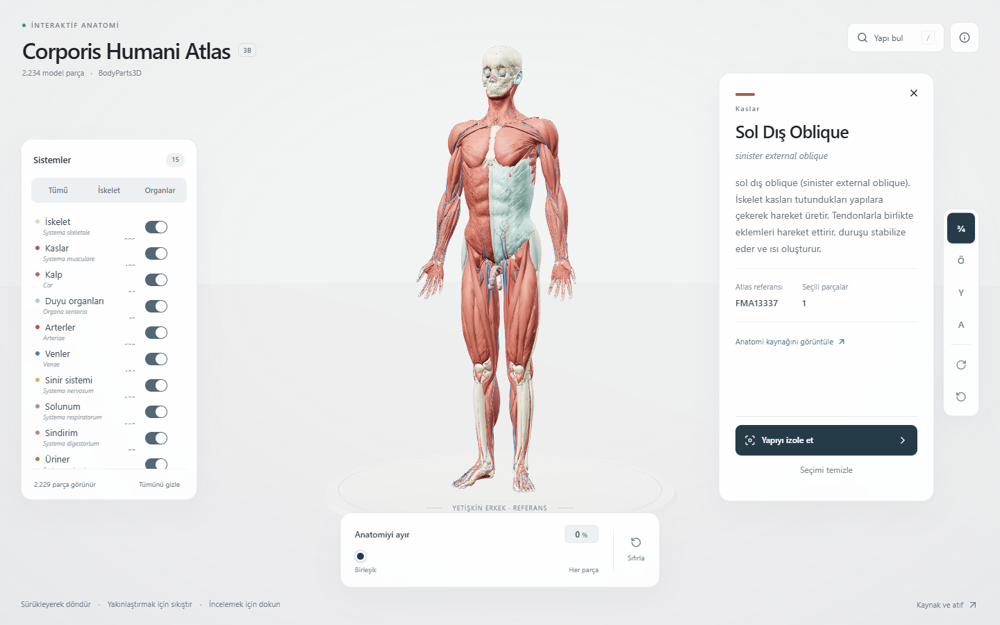

# 🧬 Corporis Humani Atlas (Interactive 3D Human Anatomy Studio)



**Corporis Humani Atlas**, **BodyParts3D** veri setini temel alan, 2.234'ten fazla anatomik modeli tarayıcı üzerinde gerçek zamanlı ve etkileşimli 3B (3D) olarak incelemenizi sağlayan modern bir web uygulamasıdır. İskelet, kas, dolaşım, sinir, solunum ve sindirim dahil olmak üzere 15 farklı anatomik sistemi katman bazlı filtreleme, parça izolasyonu, patlatılmış görünüm (explode view) ve FMA (Foundational Model of Anatomy) referanslarıyla sunar.

---

## ✨ Öne Çıkan Özellikler

- **Etkileşimli 3B Anatomi Görselleştirme:** 2.234 anatomik parça üzerinde döndürme, yakınlaştırma, seçme ve vurgulama.
- **15 Anatomik Sistem Filtresi:** İskelet (*Systema skeletale*), Kaslar (*Systema musculare*), Kalp (*Cor*), Arterler, Venler, Sinir Sistemi ve diğer sistemleri tek tıkla açıp kapatabilme.
- **Anatomik Parça İzolasyonu & Ayrıştırma:** Seçilen yapıyı izole etme veya tüm vücut sistemlerini yüzdesel olarak ayrıştırma (*Anatomiyi ayır* slider kontrolü).
- **Hızlı Yapı Arama (`/`):** Türkçe ve Latince terminoloji ile anatomik yapıları anında bulma ve kamera odaklama.
- **Detaylı Bilgi Kartları:** Seçilen her yapı için sistem bilgisi, fonksiyonel açıklama ve **FMA** (Foundational Model of Anatomy) referans kodu görüntüleme.
- **Hazır Kamera Açıları:** 3/4, Ön, Yan ve Arka standart anatomik düzlem görünümleri.

---

## 🛠️ Kullanılan Teknolojiler

| Kategori | Teknoloji |
| :--- | :--- |
| **Çatı & UI** | React 19, Vinext, TypeScript 5.9 |
| **3B Motor & Grafik** | Three.js, Meshoptimizer |
| **Stil & Tasarım Sistemi** | Tailwind CSS v4, shadcn/ui, Base UI, Lucide Icons |
| **Komut & Bileşenler** | cmdk (Hızlı Arama), Recharts, Embla Carousel, React Resizable Panels |
| **Derleme & Dağıtım** | Vite 8, Cloudflare Workers / Wrangler, Vercel |
| **Kod Kalitesi** | Oxlint, Oxfmt, TypeScript Tip Doğrulama |

---

## 📂 Proje Klasör Yapısı

```text
human-atlas/
├── app/                  # Uygulama yönlendirme ve sayfa giriş noktaları
├── components/           # 3B sahne, sistem panelleri ve UI bileşenleri
├── hooks/                # Özel React hook'ları (kamera, seçim, filtreleme)
├── lib/                  # Anatomi veri modelleri, yardımcı fonksiyonlar ve sabitler
├── public/               # 3B GLB/mesh varlıkları, ikonlar ve ekran görüntüleri
│   └── screenshots/
│       └── preview.png   # Uygulama önizleme görseli
├── scripts/              # Anatomik terim, atlas ve etkileşim doğrulama betikleri
├── web/                  # Web istemci yapılandırmaları
├── package.json          # Bağımlılıklar ve çalışma betikleri
└── vite.config.ts        # Vite derleme yapılandırması
```

---

## 🚀 Kurulum ve Çalıştırma

### Gereksinimler

- **Node.js:** `>= 22.13.0`
- **npm** (veya uyumlu paket yöneticisi)

### Adımlar

1. **Depoyu klonlayın:**
   ```bash
   git clone https://github.com/Sermedsefaa/human-atlas.git
   cd human-atlas
   ```

2. **Bağımlılıkları yükleyin:**
   ```bash
   npm install
   ```

3. **Yerel geliştirme sunucusunu başlatın:**
   ```bash
   npm run dev
   ```
   Uygulama varsayılan olarak `http://localhost:3016` adresinde çalışacaktır.

4. **Veri doğrulama ve üretim derlemesi (isteğe bağlı):**
   ```bash
   npm run validate
   npm run build
   ```

---

## 📄 Lisans ve Atıf

Bu proje **MIT Lisansı** altında lisanslanmıştır. 3B anatomik modeller **BodyParts3D** (Database Center for Life Science - DBCLS) veri setine dayanmaktadır.
